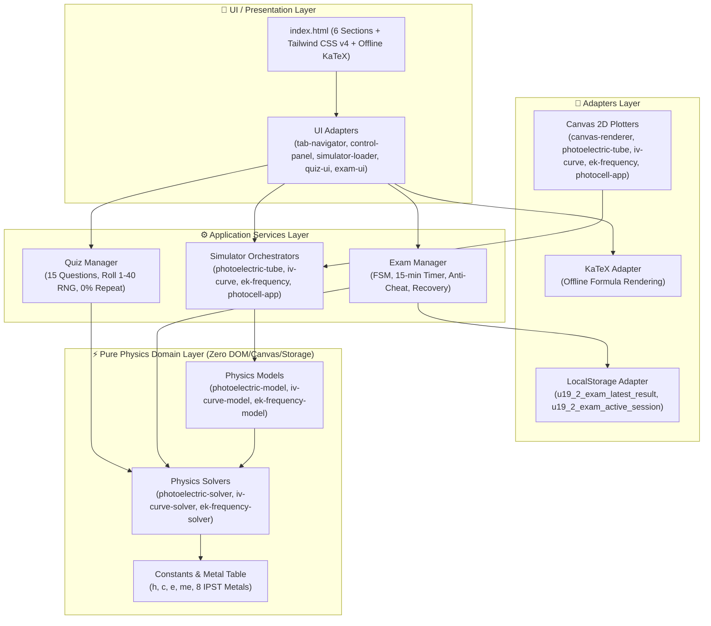

# ⚡ Interactive Physics Learning Portal
### รายวิชา ฟิสิกส์ 6 (ว33206) | บทที่ 19 ฟิสิกส์อะตอม — หัวข้อ 19.2 ปรากฏการณ์โฟโตอิเล็กทริก (Photoelectric Effect)

[](#)
[](.agents/skills/physics-learning-standard/SKILL.md)
[](#-10-สิทธิ์การใช้งาน-license)
[](#)
[](#-9-การทดสอบและการตรวจสอบความถูกต้อง-validation--testing)

---

> [!NOTE]
> 🏛️ **Architecture Reference Implementation (Physics Learning Standard v1.13.0)**
> เว็บแอปพลิเคชันการเรียนรู้ฟิสิกส์เชิงโต้ตอบสำหรับ **บทที่ 19 ฟิสิกส์อะตอม หัวข้อ 19.2 ปรากฏการณ์โฟโตอิเล็กทริก** อ้างอิงหนังสือเรียนรายวิชาเพิ่มเติมวิทยาศาสตร์และเทคโนโลยี ฟิสิกส์ ชั้น ม.6 เล่ม 6 (ฉบับปรับปรุง พ.ศ. 2560) สสวท. พัฒนาตามสถาปัตยกรรม Clean Architecture / Domain-Centric Design พร้อม 4 Interactive Simulators, ระบบฝึกทำโจทย์ไดนามิก 15 ข้อ (RNG ตามเลขที่ 1–40, Anti-Repeat 0%) และระบบสอบจับเวลา 15 นาที พร้อม Anti-Cheat และ Session Recovery 100%

---

## 📌 สารบัญ (Table of Contents)

- [1. ข้อมูลและอัตลักษณ์ของโครงการ (Project Identity)](#1-ข้อมูลและอัตลักษณ์ของโครงการ-project-identity)
- [2. สรุปภาพรวมโครงการ (Project Summary & Overview)](#2-สรุปภาพรวมโครงการ-project-summary--overview)
- [3. วัตถุประสงค์และผลการเรียนรู้ (Learning Objectives)](#3-วัตถุประสงค์และผลการเรียนรู้-learning-objectives)
- [4. ขอบเขตเนื้อหาและสูตรสำคัญ (Physics Scope & Key Formulas)](#4-ขอบเขตเนื้อหาและสูตรสำคัญ-physics-scope--key-formulas)
- [5. ฟีเจอร์การเรียนรู้ (Learning Features & Simulators)](#5-ฟีเจอร์การเรียนรู้-learning-features--simulators)
- [6. สถาปัตยกรรมระบบ (System Architecture)](#6-สถาปัตยกรรมระบบ-system-architecture)
- [7. โครงสร้างโปรเจกต์ (Project Structure)](#7-โครงสร้างโปรเจกต์-project-structure)
- [8. การติดตั้งและการใช้งาน (Installation & Quick Start)](#8-การติดตั้งและการใช้งาน-installation--quick-start)
- [9. การทดสอบและการตรวจสอบความถูกต้อง (Validation & Testing)](#9-การทดสอบและการตรวจสอบความถูกต้อง-validation--testing)
- [10. สิทธิ์การใช้งาน (License)](#10-สิทธิ์การใช้งาน-license)

---

# 1. ข้อมูลและอัตลักษณ์ของโครงการ (Project Identity)

| ข้อมูลหลัก (Field) | รายละเอียด (Value) |
| :--- | :--- |
| Repository profile | `learning-unit` |
| Standard version | `1.13.0` |
| Compliance status | `Compliant` |
| Standard reference | [physics-learning-standard](.agents/skills/physics-learning-standard/SKILL.md) |
| Maintainer | Nopphorn Somboonchai |
| Target learners | นักเรียนระดับชั้นมัธยมศึกษาปีที่ 6 (Grade 12) |
| Course | ว33206 ฟิสิกส์ 6 (หลักสูตรแกนกลางการศึกษาขั้นพื้นฐาน พ.ศ. 2560 สสวท.) |
| Unit | บทที่ 19 ฟิสิกส์อะตอม (Atomic Physics) |
| Main topic | 19.2 ปรากฏการณ์โฟโตอิเล็กทริก (Photoelectric Effect) |
| School | โรงเรียนห้องสอนศึกษา ในพระอุปถัมภ์ฯ |
| Primary UI language | ภาษาไทย ควบคู่คำศัพท์และสัญลักษณ์ทางฟิสิกส์มาตรฐานสากล |
| Learner data handling | Local only (Client-side LocalStorage: `u19_2_exam_latest_result`, `u19_2_exam_active_session`, `u19_2_user_prefs`) |

---

# 2. สรุปภาพรวมโครงการ (Project Summary & Overview)

**Interactive Physics Learning Portal (Unit 19.2)** เป็นพอร์ทัลการเรียนรู้ฟิสิกส์เชิงโต้ตอบสำหรับนักเรียนชั้น ม.6 ออกแบบตามมาตรฐานวิศวกรรมซอฟต์แวร์การศึกษา **Physics Learning Standard (v1.13.0)** และสอดคล้องกับระบบดีไซน์ของ `Unit-19-Physics Atom-19.1` ทุกประการ

### 🌟 จุดเด่นสำคัญของระบบ
1. **4 Interactive High-DPI Canvas Simulators**: จำลองหลอดโฟโตอิเล็กทริกเสมือนจริง, กราฟกระแสโฟโตอิเล็กทริก $I$–$\Delta V$ (โหมดเปรียบเทียบความเข้มแสงและความถี่), กราฟ $E_{k,\max}$–$f$ และ $V_s$–$f$ เปรียบเทียบหลายโลหะพร้อมกัน และแบบจำลองประตูอัตโนมัติด้วยเซลล์โฟโตอิเล็กทริก
2. **Dynamic Quiz Engine (15 ข้อ 3 หมวด, Anti-Repeat 0%)**: สร้างโจทย์เฉพาะบุคคลตามเลขที่นักเรียน $R \in [1, 40]$ ผสาน Attempt Seed พร้อม fallback pool ป้องกันซ้ำ 0%, รองรับโจทย์ตัวเลขเดี่ยว, 2 คำตอบ (`multi-numeric`), และปรนัย 4 ตัวเลือก พร้อมตรวจความคลาดเคลื่อน $\pm 3\%$ และเฉลย Step-by-Step ด้วย Offline KaTeX
3. **Timed Exam System (15 นาที, 5 ข้อ 10 คะแนน)**: ระบบสอบเก็บคะแนนพร้อม Anti-Cheat Monitor ตรวจจับการสลับแท็บ/หน้าต่าง, ล็อกการเปลี่ยน Section ระหว่างสอบ และ Session Recovery กู้คืนเวลาและคำตอบเมื่อรีเฟรชหน้าจอ (รวมถึง auto-submit กรณีหมดเวลาระหว่างปิดหน้าต่าง)
4. **Strict Clean Architecture**: แยก `src/physics/` เป็น Pure JS Functions 100% ปราศจาก DOM, Canvas, Storage, Network หรือ KaTeX ทำให้ทดสอบ Unit Test บน Node.js ล้วนได้ 100%

---

# 3. วัตถุประสงค์และผลการเรียนรู้ (Learning Objectives)

เมื่อเสร็จสิ้นการเรียนรู้ผ่านพอร์ทัลนี้ ผู้เรียนสามารถ:

1. **อธิบายปรากฏการณ์โฟโตอิเล็กทริกและแนวคิดโฟตอนของไอน์สไตน์**: อธิบายเงื่อนไขการหลุดของโฟโตอิเล็กตรอน ($f \ge f_0$, $\lambda \le \lambda_0$, $E \ge W$) และอธิบายเหตุผลที่ทฤษฎีคลื่นแม่เหล็กไฟฟ้าดั้งเดิมไม่สามารถอธิบายผลการทดลองทั้ง 3 ประเด็นได้
2. **คำนวณปริมาณทางฟิสิกส์ด้วยสมการของไอน์สไตน์**: คำนวณพลังงานโฟตอน ($E$), ฟังก์ชันงาน ($W$), ความถี่ขีดเริ่ม ($f_0$), ความยาวคลื่นขีดเริ่ม ($\lambda_0$), พลังงานจลน์สูงสุด ($E_{k,\max}$), ความต่างศักย์หยุดยั้ง ($V_s$) และอัตราเร็วสูงสุดของโฟโตอิเล็กตรอน ($v_{\max}$)
3. **วิเคราะห์ความสัมพันธ์เชิงกราฟ**: ตีความกราฟ $I$–$\Delta V$ (ผลของความเข้มแสงต่อ $I_{\text{sat}}$ และผลของความถี่แสงต่อ $-V_s$) และหาค่าคงตัวของพลังค์ ($h$) รวมถึงฟังก์ชันงาน ($W$) จากความชันและจุดตัดแกนของกราฟ $E_{k,\max}$–$f$ และ $V_s$–$f$
4. **เชื่อมโยงสู่การประยุกต์ใช้ในชีวิตประจำวัน**: อธิบายหลักการทำงานของเซลล์โฟโตอิเล็กทริก (Photocell) ในระบบประตูอัตโนมัติ/ลิฟต์ เครื่องนับสินค้า และสวิตช์ไฟถนนอัตโนมัติ

---

# 4. ขอบเขตเนื้อหาและสูตรสำคัญ (Physics Scope & Key Formulas)

อ้างอิงหนังสือเรียนรายวิชาเพิ่มเติม ฟิสิกส์ ชั้น ม.6 เล่ม 6 (สสวท.) โดยใช้ค่าคงที่สากลตามมาตรฐาน CODATA / สสวท.:

- ค่าคงตัวของพลังค์: $h = 6.626 \times 10^{-34}\text{ J}\cdot\text{s}$
- อัตราเร็วแสงในสุญญากาศ: $c = 3.00 \times 10^8\text{ m/s}$
- ประจุของอิเล็กตรอน: $e = 1.602 \times 10^{-19}\text{ C}$ ($1\text{ eV} = 1.602 \times 10^{-19}\text{ J}$)
- มวลของอิเล็กตรอน: $m_e = 9.109 \times 10^{-31}\text{ kg}$

### 4.1 สมการหลัก
- **พลังงานของโฟตอน 1 อนุภาค**:
  $$E = hf = \frac{hc}{\lambda}$$
- **ฟังก์ชันงาน (Work Function) และค่าขีดเริ่ม**:
  $$W = hf_0 = \frac{hc}{\lambda_0}$$
- **สมการโฟโตอิเล็กทริกของไอน์สไตน์**:
  $$E_{k,\max} = hf - W = hf - hf_0 = \frac{hc}{\lambda} - W$$
- **ความต่างศักย์หยุดยั้ง ($V_s$) และอัตราเร็วสูงสุด ($v_{\max}$)**:
  $$E_{k,\max} = eV_s = \frac{1}{2}m_e v_{\max}^2 \qquad \Longleftrightarrow \qquad V_s = \left(\frac{h}{e}\right)f - \frac{W}{e}$$

### 4.2 ตารางฟังก์ชันงานของโลหะมาตรฐาน (สสวท.)
| โลหะ (Metal) | สัญลักษณ์ | ฟังก์ชันงาน $W$ (eV) | ความถี่ขีดเริ่ม $f_0$ ($\times 10^{14}\text{ Hz}$) | ความยาวคลื่นขีดเริ่ม $\lambda_0$ (nm) | ย่านสเปกตรัมของ $\lambda_0$ |
| :--- | :---: | :---: | :---: | :---: | :--- |
| ซีเซียม (Cesium) | $\text{Cs}$ | `2.1` | `5.08` | `590.9` | แสงที่ตามองเห็น (ส้ม-เหลือง) |
| โพแทสเซียม (Potassium) | $\text{K}$ | `2.3` | `5.56` | `539.5` | แสงที่ตามองเห็น (เขียว) |
| โซเดียม (Sodium) | $\text{Na}$ | `2.4` | `5.80` | `517.0` | แสงที่ตามองเห็น (เขียว) |
| แคลเซียม (Calcium) | $\text{Ca}$ | `2.9` | `7.01` | `427.9` | แสงที่ตามองเห็น (คราม-น้ำเงิน) |
| อะลูมิเนียม (Aluminum) | $\text{Al}$ | `4.2` | `10.15` | `295.4` | อัลตราไวโอเลต (UV) |
| สังกะสี (Zinc) | $\text{Zn}$ | `4.3` | `10.40` | `288.6` | อัลตราไวโอเลต (UV) |
| ทองแดง (Copper) | $\text{Cu}$ | `4.8` | `11.61` | `258.5` | อัลตราไวโอเลต (UV) |
| ทองคำ (Gold) | $\text{Au}$ | `5.1` | `12.33` | `243.3` | อัลตราไวโอเลต (UV) |

### 4.3 สมมติฐานและข้อจำกัดของแบบจำลอง (Assumptions & Limitations)
- หลอดโฟโตอิเล็กทริกเป็นสุญญากาศสมบูรณ์ ไม่มีแรงต้านอากาศหรือการชนโมเลกุลแก๊ส
- อัตราเร็วของโฟโตอิเล็กตรอนอยู่ในช่วง Non-relativistic ($v_{\max} \ll c$) จึงใช้ $E_{k,\max} = \frac{1}{2}m_e v_{\max}^2$ ได้อย่างแม่นยำ
- ฟังก์ชันงาน $W$ เป็นค่าคงตัวสำหรับผิวโลหะบริสุทธิ์ที่อุณหภูมิห้อง ไม่รวมผลของความร้อน (Thermionic Emission)

---

# 5. ฟีเจอร์การเรียนรู้ (Learning Features & Simulators)

1. **Simulator 1 — หลอดโฟโตอิเล็กทริกเสมือนจริง (`19-2-tube`)**: ปรับเลือกโลหะ 8 ชนิด, ความยาวคลื่น `150–750 nm`, ความเข้มแสง `0–100%`, ความต่างศักย์ `-5.0 ถึง +5.0 V`, ปุ่มลัดตั้งค่าที่ศักย์หยุดยั้ง (`-Vs`), แสดงการเร่ง/หน่วง/ย้อนกลับของโฟโตอิเล็กตรอน, แอมมิเตอร์ ($\mu\text{A}$), โวลต์มิเตอร์ ($\text{V}$) และป้ายเตือนเมื่อ $f < f_0$
2. **Simulator 2 — กราฟกระแสโฟโตอิเล็กทริก $I$–$\Delta V$ (`19-2-iv`)**: สลับโหมดเปรียบเทียบ **โหมด A (เปลี่ยนความเข้มแสง, $f$ คงที่)** กับ **โหมด B (เปลี่ยนความถี่แสง, ความเข้มคงที่)** พร้อมจุดทำงานแบบ Interactive
3. **Simulator 3 — กราฟ $E_{k,\max}$–$f$ และ $V_s$–$f$ (`19-2-ekf`)**: สลับแกน Y ได้ระหว่าง $E_{k,\max}$ (eV) กับ $V_s$ (V), เปรียบเทียบโลหะพร้อมกันได้สูงสุด 3 ชนิด พิสูจน์เส้นตรงขนานกัน (ความชัน $h$ หรือ $h/e$), เส้นประต่อจุดตัด $-W$ และตัวชี้ความถี่แบบ Real-time
4. **Simulator 4 — คลื่น vs โฟตอน & ประตูอัตโนมัติ (`19-2-photocell`)**: จำลองคนเดินผ่านลำแสงเซนเซอร์เซลล์โฟโตอิเล็กทริก (Cs) แสดงกระแสตกเป็น $0\text{ }\mu\text{A}$ → รีเลย์สั่งมอเตอร์เปิดประตูอัตโนมัติ พร้อมตารางสรุปเปรียบเทียบทฤษฎีคลื่นดั้งเดิม vs โฟตอนของไอน์สไตน์ 3 ประเด็น
5. **Practice Arena (`sec-practice`)**: คลังโจทย์ 15 ข้อ (3 หมวด × 5 ข้อ: `19.2.1`, `19.2.2`, `19.2.3`) โหมดมาตรฐาน สสวท. และโหมดสุ่ม RNG ตามเลขที่ `R ∈ [1, 40]` รับประกัน 0% repeat (`maxRetries = 50` + deterministic unused-pool fallback), เกณฑ์ตรวจคำตอบตัวเลข **$\pm 3\%$**, พร้อมเฉลย KaTeX ทีละขั้น
6. **Timed Exam (`sec-exam-start`, `sec-exam-live`, `sec-exam-result`)**: ข้อสอบ 5 ข้อ (10 คะแนนเต็ม, ผ่าน 6 คะแนน / 60%) เวลา 15:00 นาที, นาฬิกาเริ่มเดินหลังกดเริ่มสอบเท่านั้น, ระบบ Anti-Cheat นับการสลับแท็บพร้อม Toast เตือนสั่น, ล็อกการเปลี่ยนหน้า, และ Session Recovery ผ่าน LocalStorage (`u19_2_*`, `syncStatus: 'local-only'`)

---

# 6. สถาปัตยกรรมระบบ (System Architecture)

ออกแบบตาม **Clean / Domain-Centric Architecture** ของ Physics Learning Standard v1.13.0 โดยทิศทาง Dependency ไหลเข้าสู่โดเมนฟิสิกส์เท่านั้น:



---

# 7. โครงสร้างโปรเจกต์ (Project Structure)

```text
Unit-19-Physics Atom-19.2/
├── .agents/skills/                         # Physics Learning Standard v1.13.0 & Compliance Scripts
├── .github/workflows/deploy.yml            # GitHub Pages CI/CD auto-deploy
├── assets/styles/
│   ├── animations.css                      # Keyframes, Glow, Timer Urgent, Reduced Motion
│   ├── main.css                            # Tailwind CSS v4 + Engineering Grid Theme + Anti-Cheat Toast
│   └── style.css                           # Compiled Tailwind CSS
├── dist/bundle.js                          # Production esbuild bundle
├── src/
│   ├── main.js                             # Entry point, Error Boundary, KaTeX init
│   ├── shared/
│   │   ├── config.js                       # APP_CONFIG (15 min, 5 Qs, 10 marks, roll 1-40, ±3%, u19_2_* keys)
│   │   └── constants.js                    # h, c, e, me, EV_TO_JOULES, 8 IPST metal work functions
│   ├── utils/
│   │   ├── format.js                       # Scientific notation, LaTeX formatting, eV/J/nm/Hz/µA
│   │   ├── random.js                       # Mulberry32 Seeded RNG, getDynamicParam, Fisher-Yates shuffle
│   │   └── validation.js                   # Roll 1-40 validation & ±3% numeric tolerance grading
│   ├── physics/                            # Pure Physics Domain (Zero DOM/Canvas/Storage/KaTeX)
│   │   ├── photoelectric-model.js          # 8-metal catalog & virtual photoelectric tube snapshot
│   │   ├── photoelectric-solver.js         # E, W, f₀, λ₀, Ek,max, Vs, vmax, wavelengthToRGB
│   │   ├── iv-curve-model.js               # I vs ΔV comparison curves (Mode A Intensity & Mode B Frequency)
│   │   ├── iv-curve-solver.js              # I(ΔV), saturation current Isat, exact -Vs cutoff
│   │   ├── ek-frequency-model.js           # Multi-metal Ek,max–f & Vs–f parallel graph model
│   │   └── ek-frequency-solver.js          # Slopes (h, h/e), two-point h deduction, W deduction
│   ├── application/                        # Orchestrators & State Machines (Zero concrete DOM/Storage)
│   │   ├── photoelectric-tube-simulator.js # Simulator 1 Orchestrator
│   │   ├── iv-curve-simulator.js           # Simulator 2 Orchestrator
│   │   ├── ek-frequency-simulator.js       # Simulator 3 Orchestrator
│   │   ├── photocell-app-simulator.js      # Simulator 4 Orchestrator
│   │   ├── quiz-manager.js                 # 15-Question Dynamic RNG Quiz Engine
│   │   └── exam-manager.js                 # 15-min Timed Exam FSM + Anti-Cheat + Recovery
│   └── adapters/
│       ├── canvas/
│       │   ├── canvas-renderer.js          # High-DPI Canvas 2D Engine + ResizeObserver
│       │   ├── photoelectric-tube-plotter.js
│       │   ├── iv-curve-plotter.js
│       │   ├── ek-frequency-plotter.js
│       │   └── photocell-app-plotter.js
│       ├── formula/katex-adapter.js        # Local Offline KaTeX Adapter
│       ├── storage/local-storage.js        # Isolated u19_2_* LocalStorage Adapter
│       └── ui/
│           ├── tab-navigator.js            # 6 Sections + 4 Sub-Tabs + Exam Navigation Lock
│           ├── simulator-loader.js         # Calibrator Progress Loader Overlay
│           ├── control-panel.js            # DOM Controls & Real-time Readouts Adapter
│           ├── quiz-ui.js                  # Practice Arena UI
│           └── exam-ui.js                  # Exam UI + Anti-Cheat Toast + Recovery Modal
├── tests/
│   ├── physics.test.js                     # Pure Node.js Physics Accuracy Audit
│   ├── quiz.test.js                        # 15 Questions, Roll 1-40, Anti-Repeat 0%, ±3%
│   ├── exam.test.js                        # FSM, 15-min Timer, Anti-Cheat, Recovery & Timeout
│   ├── integration.test.js                 # Clean Architecture & Cross-Layer Integration
│   ├── viewport-geometry.test.js           # 5 Viewports Clearance (360, 393, 768, 1024, 1440 px)
│   ├── simulator-loader.test.js            # Calibrator Loader State & Anti-Duplicate Audit
│   └── e2e/                                # Static Server & E2E Smoke Test
├── vendor/katex/                           # Offline KaTeX Assets (No CDN)
├── index.html                              # Main 6-Section SPA
├── e2e.config.ts
├── package.json
├── LICENSE
└── README.md
```

---

# 8. การติดตั้งและการใช้งาน (Installation & Quick Start)

### ความต้องการของระบบ
- [Node.js](https://nodejs.org/) เวอร์ชัน 18.0.0 ขึ้นไป
- เว็บเบราว์เซอร์สมัยใหม่ที่รองรับ ES2025 Modules

### คำสั่งติดตั้งและรันใช้งาน
```bash
# 1. ติดตั้งแพ็กเกจ
npm install

# 2. คอมไพล์ CSS (Tailwind v4) และ Bundle JS (esbuild)
npm run build

# 3. รันชุดทดสอบอัตโนมัติครบทั้ง 6 Test Suites
npm test

# 4. เปิดเซิร์ฟเวอร์จำลองเพื่อใช้งานบนเบราว์เซอร์
npm run serve
```

---

# 9. การทดสอบและการตรวจสอบความถูกต้อง (Validation & Testing)

สามารถตรวจสอบความถูกต้องของระบบทั้งหมดได้ด้วยคำสั่ง:

```bash
npm run build && npm test
```

และตรวจสอบความสอดคล้องตามมาตรฐาน **Physics Learning Standard v1.13.0** ด้วยสคริปต์:

```powershell
powershell -ExecutionPolicy Bypass -File .\.agents\skills\physics-learning-standard\references\scripts\validate-repository.ps1 -Target .
```

### สรุปขอบเขตชุดทดสอบทั้ง 6 Suites
1. **`tests/physics.test.js`**: ตรวจค่าคงที่ CODATA/สสวท., ตารางโลหะ 8 ชนิด, สูตร $E$, $W$, $f_0$, $\lambda_0$, $E_{k,\max}$, $V_s$, $v_{\max}$, เงื่อนไข $f < f_0$, กราฟ $I$–$\Delta V$ (โหมดความเข้ม/ความถี่) และความชันกราฟ $E_{k,\max}$–$f$ / $V_s$–$f$ บน Node.js ล้วน
2. **`tests/quiz.test.js`**: ตรวจขอบเขตเลขที่ 1–40, ครบทั้ง 15 ข้อ (3 หมวด × 5 ข้อ), โหมด `standard` vs `random`, anti-repeat 0%, และความคลาดเคลื่อน $\pm 3\%$
3. **`tests/exam.test.js`**: ตรวจ FSM (`IDLE → IN_PROGRESS → SUBMITTED`), 5 ข้อ 10 คะแนน, นาฬิกา 15:00 นาที, Anti-Cheat, และ Session Recovery รวมถึงเคส `timeout-on-recovery`
4. **`tests/integration.test.js`**: ตรวจขอบเขต Clean Architecture (ยืนยันว่า `src/physics/` และ `src/application/` ปราศจาก DOM/Canvas/Browser Storage) และการไหลของข้อมูลข้ามเลเยอร์
5. **`tests/viewport-geometry.test.js`**: ตรวจระยะขอบและสัดส่วน Canvas ทั้ง 4 Simulators บน 5 ขนาดหน้าจอ (`360px`, `393px`, `768px`, `1024px`, `1440px`)
6. **`tests/simulator-loader.test.js`**: ตรวจสถานะ Calibrator Loader และการป้องกันการโหลดซ้ำ

---

# 10. สิทธิ์การใช้งาน (License)

โครงการนี้เผยแพร่ภายใต้สัญญาอนุญาตสิทธิ์ [MIT License](LICENSE) สามารถนำไปใช้เพื่อประโยชน์ทางการศึกษา พัฒนาต่อยอด และเผยแพร่ได้อย่างเสรี
# Unit-19-Physics-Atom-19.2

