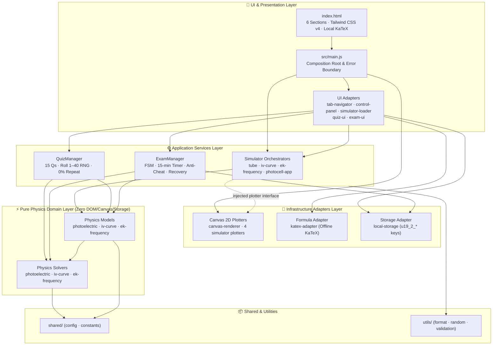

# ⚡ Interactive Physics Learning Portal (Unit 19.2)

> **รายวิชา ฟิสิกส์ 6 (ว33206) | บทที่ 19 ฟิสิกส์อะตอม — หัวข้อ 19.2 ปรากฏการณ์โฟโตอิเล็กทริก (Photoelectric Effect)**

[](#4-ขอบเขตเนื้อหาและสูตรสำคัญ-physics-scope-and-key-formulas)
[](.agents/skills/physics-learning-standard/SKILL.md)
[](#1-ข้อมูลและอัตลักษณ์ของโครงการ-project-identity)
[](#9-การทดสอบและการตรวจสอบความถูกต้อง-validation-and-testing)
[](LICENSE)

---

> [!NOTE]
> **Architecture Reference Implementation (`learning-unit` · Physics Learning Standard v1.13.0)**
> เว็บแอปพลิเคชันการเรียนรู้ฟิสิกส์เชิงโต้ตอบสำหรับ **บทที่ 19 ฟิสิกส์อะตอม หัวข้อ 19.2 ปรากฏการณ์โฟโตอิเล็กทริก** อ้างอิงหนังสือเรียนรายวิชาเพิ่มเติมวิทยาศาสตร์และเทคโนโลยี ฟิสิกส์ ชั้น ม.6 เล่ม 6 (ฉบับปรับปรุง พ.ศ. 2560) สสวท. พัฒนาตามสถาปัตยกรรม Clean / Domain-Centric Architecture พร้อม 4 Interactive Canvas Simulators, ระบบฝึกทำโจทย์ไดนามิก 15 ข้อ (`R ∈ [1, 40]`, Anti-Repeat 0%) และระบบสอบจับเวลา 15 นาที พร้อม Anti-Cheat และ Session Recovery

---

## 📌 สารบัญ (Table of Contents)

- [1. ข้อมูลและอัตลักษณ์ของโครงการ (Project Identity)](#1-ข้อมูลและอัตลักษณ์ของโครงการ-project-identity)
- [2. สรุปภาพรวมโครงการ (Project Summary and Overview)](#2-สรุปภาพรวมโครงการ-project-summary-and-overview)
- [3. วัตถุประสงค์และผลการเรียนรู้ (Learning Objectives)](#3-วัตถุประสงค์และผลการเรียนรู้-learning-objectives)
- [4. ขอบเขตเนื้อหาและสูตรสำคัญ (Physics Scope and Key Formulas)](#4-ขอบเขตเนื้อหาและสูตรสำคัญ-physics-scope-and-key-formulas)
- [5. ฟีเจอร์การเรียนรู้และแบบจำลอง (Learning Features and Simulators)](#5-ฟีเจอร์การเรียนรู้และแบบจำลอง-learning-features-and-simulators)
- [6. สถาปัตยกรรมระบบ (System Architecture)](#6-สถาปัตยกรรมระบบ-system-architecture)
- [7. โครงสร้างโปรเจกต์ (Project Structure)](#7-โครงสร้างโปรเจกต์-project-structure)
- [8. การติดตั้ง การใช้งาน และการเผยแพร่ (Installation, Usage and Deployment)](#8-การติดตั้ง-การใช้งาน-และการเผยแพร่-installation-usage-and-deployment)
- [9. การทดสอบและการตรวจสอบความถูกต้อง (Validation and Testing)](#9-การทดสอบและการตรวจสอบความถูกต้อง-validation-and-testing)
- [10. มาตรฐานการเข้าถึง ความปลอดภัย และแนวทาง AI (Accessibility, Privacy and AI Notes)](#10-มาตรฐานการเข้าถึง-ความปลอดภัย-และแนวทาง-ai-accessibility-privacy-and-ai-notes)
- [11. เอกสารอ้างอิงและสิทธิ์การใช้งาน (References and License)](#11-เอกสารอ้างอิงและสิทธิ์การใช้งาน-references-and-license)

---

# 1. ข้อมูลและอัตลักษณ์ของโครงการ (Project Identity)

| ข้อมูลหลัก (Field) | รายละเอียด (Value) |
| :--- | :--- |
| Repository profile | `learning-unit` |
| Standard version | `1.13.0` |
| Compliance status | `Compliant` |
| Standard reference | [physics-learning-standard](.agents/skills/physics-learning-standard/SKILL.md) |
| Maintainer | Nopphorn Somboonchai |
| Target learners | นักเรียนระดับชั้นมัธยมศึกษาปีที่ 6 (Grade 12) |
| Course | ว33206 ฟิสิกส์ 6 (หลักสูตรแกนกลางการศึกษาขั้นพื้นฐาน พ.ศ. 2560 สสวท.) |
| Unit | บทที่ 19 ฟิสิกส์อะตอม (Atomic Physics) |
| Main topic | 19.2 ปรากฏการณ์โฟโตอิเล็กทริก (Photoelectric Effect) |
| School | โรงเรียนห้องสอนศึกษา ในพระอุปถัมภ์ฯ |
| Primary UI language | ภาษาไทย ควบคู่คำศัพท์และสัญลักษณ์ทางฟิสิกส์มาตรฐานสากล |
| Learner data handling | Local only (`u19_2_exam_latest_result`, `u19_2_exam_active_session`, `u19_2_user_prefs`) |

---

# 2. สรุปภาพรวมโครงการ (Project Summary and Overview)

**Interactive Physics Learning Portal (Unit 19.2)** เป็นพอร์ทัลการเรียนรู้ฟิสิกส์เชิงโต้ตอบสำหรับนักเรียนชั้น ม.6 ออกแบบตามมาตรฐานวิศวกรรมซอฟต์แวร์การศึกษา **Physics Learning Standard (v1.13.0)** เพื่อให้ผู้เรียนเข้าใจปรากฏการณ์โฟโตอิเล็กทริกตั้งแต่ระดับแนวคิดเชิงปริมาณ การวิเคราะห์กราฟ ไปจนถึงการประยุกต์ใช้งานจริง

## 🌟 จุดเด่นสำคัญของระบบ

1. **4 Interactive High-DPI Canvas Simulators**: จำลองหลอดโฟโตอิเล็กทริกเสมือนจริง, กราฟกระแสโฟโตอิเล็กทริก $I\text{–}\Delta V$ (โหมดเปรียบเทียบความเข้มแสงและความถี่), กราฟ $E_{k,\max}\text{–}f$ และ $V_s\text{–}f$ เปรียบเทียบโลหะพร้อมกันสูงสุด 3 ชนิด และแบบจำลองประตูอัตโนมัติด้วยเซลล์โฟโตอิเล็กทริก
2. **Dynamic Quiz Engine (15 ข้อ 3 หมวด, Anti-Repeat 0%)**: สร้างโจทย์เฉพาะบุคคลตามเลขที่นักเรียน $R \in [1, 40]$ ผสาน Attempt Seed พร้อมระบบ fallback ป้องกันค่าซ้ำ 0%, รองรับโจทย์ตัวเลขเดี่ยว, 2 คำตอบ (`multi-numeric`), และปรนัย 4 ตัวเลือก พร้อมตรวจความคลาดเคลื่อน $\pm 3\%$ และเฉลยทีละขั้นด้วย Offline KaTeX
3. **Timed Exam System (15 นาที, 5 ข้อ 10 คะแนน)**: ระบบสอบเก็บคะแนนพร้อม Anti-Cheat Monitor ตรวจจับการสลับแท็บ/หน้าต่าง, ล็อกการเปลี่ยนหน้าจอระหว่างสอบ และ Session Recovery กู้คืนเวลาที่เหลือและคำตอบเมื่อรีเฟรชหน้าจอ (รวมถึง auto-submit กรณีหมดเวลาระหว่างปิดหน้าต่าง)
4. **Strict Clean Architecture**: แยก `src/physics/` เป็น Pure JavaScript Functions 100% ปราศจาก DOM, Canvas, Storage, Network หรือ KaTeX ทำให้สามารถทดสอบความถูกต้องทางฟิสิกส์บน Node.js ล้วนได้อย่างสมบูรณ์

---

# 3. วัตถุประสงค์และผลการเรียนรู้ (Learning Objectives)

เมื่อเสร็จสิ้นการเรียนรู้ผ่านพอร์ทัลนี้ ผู้เรียนสามารถ:

1. **อธิบายปรากฏการณ์โฟโตอิเล็กทริกและแนวคิดโฟตอนของไอน์สไตน์**: อธิบายเงื่อนไขการหลุดของโฟโตอิเล็กตรอน ($f \ge f_0$, $\lambda \le \lambda_0$, $E \ge W$) และเหตุผลที่ทฤษฎีคลื่นแม่เหล็กไฟฟ้าดั้งเดิมไม่สามารถอธิบายผลการทดลองทั้ง 3 ประเด็นได้
2. **คำนวณปริมาณทางฟิสิกส์ด้วยสมการของไอน์สไตน์**: คำนวณพลังงานโฟตอน ($E$), ฟังก์ชันงาน ($W$), ความถี่ขีดเริ่ม ($f_0$), ความยาวคลื่นขีดเริ่ม ($\lambda_0$), พลังงานจลน์สูงสุด ($E_{k,\max}$), ความต่างศักย์หยุดยั้ง ($V_s$) และอัตราเร็วสูงสุดของโฟโตอิเล็กตรอน ($v_{\max}$)
3. **วิเคราะห์ความสัมพันธ์เชิงกราฟ**: ตีความกราฟ $I\text{–}\Delta V$ (ผลของความเข้มแสงต่อ $I_{\text{sat}}$ และผลของความถี่แสงต่อ $-V_s$) รวมถึงหาค่าคงตัวของพลังค์ ($h$) และฟังก์ชันงาน ($W$) จากความชันและจุดตัดแกนของกราฟ $E_{k,\max}\text{–}f$ และ $V_s\text{–}f$
4. **เชื่อมโยงสู่การประยุกต์ใช้ในชีวิตประจำวัน**: อธิบายหลักการทำงานของเซลล์โฟโตอิเล็กทริก (Photocell) ในระบบประตูอัตโนมัติ/ลิฟต์ เครื่องนับสินค้า และสวิตช์ไฟถนนอัตโนมัติ

---

# 4. ขอบเขตเนื้อหาและสูตรสำคัญ (Physics Scope and Key Formulas)

อ้างอิงหนังสือเรียนรายวิชาเพิ่มเติม ฟิสิกส์ ชั้น ม.6 เล่ม 6 (สสวท.) โดยใช้ค่าคงที่ทางฟิสิกส์มาตรฐานสากลตาม CODATA / สสวท.

## 4.1 ค่าคงที่ทางฟิสิกส์ (Constants)

| สัญลักษณ์ | ความหมาย | ค่าคงที่ | หน่วย | แหล่งอ้างอิง |
| :--- | :--- | :--- | :--- | :--- |
| $h$ | ค่าคงตัวของพลังค์ | `6.626e-34` ($6.626 \times 10^{-34}$) | $\text{J}\cdot\text{s}$ | CODATA / สสวท. |
| $c$ | อัตราเร็วแสงในสุญญากาศ | `3.00e8` ($3.00 \times 10^8$) | $\text{m/s}$ | CODATA / สสวท. |
| $e$ | ประจุของอิเล็กตรอน | `1.602e-19` ($1.602 \times 10^{-19}$) | $\text{C}$ | CODATA / สสวท. ($1\,\text{eV} = 1.602 \times 10^{-19}\,\text{J}$) |
| $m_e$ | มวลของอิเล็กตรอน | `9.109e-31` ($9.109 \times 10^{-31}$) | $\text{kg}$ | CODATA / สสวท. |

## 4.2 สมการหลัก (Key Formulas)

- **พลังงานของโฟตอน 1 อนุภาค**

  $$
  E = hf = \frac{hc}{\lambda}
  $$

- **ฟังก์ชันงาน (Work Function) และค่าขีดเริ่ม**

  $$
  W = hf_0 = \frac{hc}{\lambda_0}
  $$

- **สมการโฟโตอิเล็กทริกของไอน์สไตน์**

  $$
  E_{k,\max} = hf - W = hf - hf_0 = \frac{hc}{\lambda} - W
  $$

- **ความต่างศักย์หยุดยั้ง ($V_s$) และอัตราเร็วสูงสุด ($v_{\max}$)**

  $$
  E_{k,\max} = eV_s = \frac{1}{2}m_e v_{\max}^2
  $$

- **ความสัมพันธ์เชิงเส้นของศักย์หยุดยั้งกับความถี่แสง**

  $$
  V_s = \left(\frac{h}{e}\right)f - \frac{W}{e}
  $$

## 4.3 ตารางฟังก์ชันงานของโลหะมาตรฐาน (สสวท.)

| โลหะ (Metal) | สัญลักษณ์ | ฟังก์ชันงาน $W$ ($\text{eV}$) | ความถี่ขีดเริ่ม $f_0$ ($\times 10^{14}\,\text{Hz}$) | ความยาวคลื่นขีดเริ่ม $\lambda_0$ ($\text{nm}$) | ย่านสเปกตรัมของ $\lambda_0$ |
| :--- | :---: | :---: | :---: | :---: | :--- |
| ซีเซียม (Cesium) | $\text{Cs}$ | `2.1` | `5.08` | `590.9` | แสงที่ตามองเห็น (ส้ม-เหลือง) |
| โพแทสเซียม (Potassium) | $\text{K}$ | `2.3` | `5.56` | `539.5` | แสงที่ตามองเห็น (เขียว) |
| โซเดียม (Sodium) | $\text{Na}$ | `2.4` | `5.80` | `517.0` | แสงที่ตามองเห็น (เขียว) |
| แคลเซียม (Calcium) | $\text{Ca}$ | `2.9` | `7.01` | `427.9` | แสงที่ตามองเห็น (คราม-น้ำเงิน) |
| อะลูมิเนียม (Aluminum) | $\text{Al}$ | `4.2` | `10.15` | `295.4` | อัลตราไวโอเลต (UV) |
| สังกะสี (Zinc) | $\text{Zn}$ | `4.3` | `10.40` | `288.6` | อัลตราไวโอเลต (UV) |
| ทองแดง (Copper) | $\text{Cu}$ | `4.8` | `11.61` | `258.5` | อัลตราไวโอเลต (UV) |
| ทองคำ (Gold) | $\text{Au}$ | `5.1` | `12.33` | `243.3` | อัลตราไวโอเลต (UV) |

## 4.4 สมมติฐานและข้อจำกัดของแบบจำลอง (Assumptions and Limitations)

- หลอดโฟโตอิเล็กทริกเป็นสุญญากาศสมบูรณ์ ไม่มีแรงต้านอากาศหรือการชนโมเลกุลแก๊ส
- อัตราเร็วของโฟโตอิเล็กตรอนอยู่ในช่วง Non-relativistic ($v_{\max} \ll c$) จึงใช้ $E_{k,\max} = \frac{1}{2}m_e v_{\max}^2$ ได้อย่างแม่นยำ
- ฟังก์ชันงาน $W$ เป็นค่าคงตัวสำหรับผิวโลหะบริสุทธิ์ที่อุณหภูมิห้อง ไม่รวมผลของการปล่อยอิเล็กตรอนจากความร้อน (Thermionic Emission)
- ค่าคงตัวสากลและผลลัพธ์เชิงทฤษฎีอาจมีการปัดเศษเพื่อความเหมาะสมทางการสอน โดยระบบตรวจคำตอบเปิดช่วงความคลาดเคลื่อนที่ $\pm 3\%$

---

# 5. ฟีเจอร์การเรียนรู้และแบบจำลอง (Learning Features and Simulators)

## 5.1 แบบจำลองเชิงโต้ตอบ (4 Interactive Simulators)

1. **Simulator 1 — หลอดโฟโตอิเล็กทริกเสมือนจริง (`19-2-tube`)**: เลือกโลหะมาตรฐาน 8 ชนิด, ปรับความยาวคลื่น `150–750 nm`, ความเข้มแสง `0–100%`, ความต่างศักย์ `-5.0` ถึง `+5.0 V`, ปุ่มลัดตั้งค่าศักย์หยุดยั้ง (`-Vs`), แสดงการเร่ง/หน่วง/ย้อนกลับของโฟโตอิเล็กตรอน, แอมมิเตอร์ ($\mu\text{A}$), โวลต์มิเตอร์ ($\text{V}$) และป้ายเตือนเมื่อ $f < f_0$
2. **Simulator 2 — กราฟกระแสโฟโตอิเล็กทริก $I\text{–}\Delta V$ (`19-2-iv`)**: ปรับความยาวคลื่น `180–680 nm`, ความเข้มแสง `20–100%`, ความต่างศักย์ทำงาน `-5.0` ถึง `+5.0 V` พร้อมสลับ **โหมด A (เปรียบเทียบความเข้มแสง, $f$ คงที่)** และ **โหมด B (เปรียบเทียบความถี่แสง, ความเข้มคงที่)** รวมถึงจุดทำงานแบบ Interactive
3. **Simulator 3 — กราฟ $E_{k,\max}\text{–}f$ และ $V_s\text{–}f$ (`19-2-ekf`)**: สลับแกน Y ได้ระหว่าง $E_{k,\max}$ ($\text{eV}$) กับ $V_s$ ($\text{V}$), เลือกเปรียบเทียบโลหะพร้อมกันได้ 1–3 ชนิด เพื่อพิสูจน์เส้นตรงขนานกัน (ความชัน $h$ หรือ $h/e$), เส้นประต่อจุดตัดแกน $-W$ หรือ $-W/e$ และตัวชี้ความถี่ช่วง `1.0–20.0 × 10¹⁴ Hz` แบบ Real-time
4. **Simulator 4 — คลื่น vs โฟตอน และประตูอัตโนมัติ (`19-2-photocell`)**: จำลองคนเดินผ่านลำแสงเซนเซอร์เซลล์โฟโตอิเล็กทริก ($\text{Cs}$, ปรับความยาวคลื่น `280–700 nm`) แสดงกระแสตกเป็น $0\,\mu\text{A}$ เมื่อลำแสงถูกบัง แล้วรีเลย์สั่งมอเตอร์เปิดประตูอัตโนมัติ พร้อมตารางเปรียบเทียบทฤษฎีคลื่นดั้งเดิมกับโฟตอนของไอน์สไตน์ 3 ประเด็น

## 5.2 ระบบฝึกทำโจทย์ไดนามิก (Practice Arena — `sec-practice`)

- **โครงสร้างคลังโจทย์**: 15 ข้อ แบ่งเป็น 3 หมวด × 5 ข้อ (`19.2.1` พลังงานโฟตอนและค่าขีดเริ่ม, `19.2.2` สมการของไอน์สไตน์และความเร็วสูงสุด, `19.2.3` การวิเคราะห์กราฟและการประยุกต์)
- **โหมดการทำงาน**: โหมดมาตรฐาน สสวท. (`standard`) และโหมดสุ่มเฉพาะบุคคล (`random`) ตามเลขที่นักเรียน `R ∈ [1, 40]` ผสาน `attemptSeed`
- **กลไกป้องกันค่าซ้ำ (Fallback Strategy)**: ใช้ `maxRetries = 50` หลีกเลี่ยงค่ามาตรฐานและค่าที่เคยสุ่มแล้วในเซสชัน หากครบ 50 รอบแล้วยังชน จะสร้างสระค่าที่ยังไม่เคยใช้แบบ Deterministic (`unusedPool`) โดยหากใช้ครบทุกค่าจะรีเซ็ตประวัติยกเว้นค่าล่าสุด เพื่อรับประกันว่าผู้เรียนได้รับโจทย์ต่อเนื่องเสมอโดยไม่ซ้ำเดิม
- **การตรวจคำตอบและผลป้อนกลับ**: รองรับคำตอบตัวเลขเดี่ยว, 2 คำตอบ (`multi-numeric`) และปรนัย 4 ตัวเลือก ตรวจค่าตัวเลขด้วยความคลาดเคลื่อน $\pm 3\%$ พร้อมเฉลยวิธีทำทีละขั้นด้วย Offline KaTeX

## 5.3 ระบบสอบเก็บคะแนนแบบจับเวลา (Timed Exam System)

| รายการ (Field) | รายละเอียด (Configuration) |
| :--- | :--- |
| Exam title | แบบทดสอบวัดผลสัมฤทธิ์ บทที่ 19.2 ปรากฏการณ์โฟโตอิเล็กทริก |
| Content scope | หลักการโฟโตอิเล็กทริก, ค่าขีดเริ่ม, สมการไอน์สไตน์, กราฟ $E_{k,\max}\text{–}f$ / $I\text{–}\Delta V$ และโฟโตเซลล์ |
| Number of questions | 5 ข้อ (ข้อ 1 ปรนัย 4 ตัวเลือก, ข้อ 2–5 เติมคำตอบเชิงตัวเลข) |
| Points & passing rule | ข้อละ 2 คะแนน, คะแนนเต็ม 10 คะแนน (เกณฑ์ผ่าน 6 คะแนน / 60%) |
| Time limit | 15:00 นาที (`900` วินาที) — นาฬิกาเริ่มเดินหลังกดเริ่มทำข้อสอบที่ `sec-exam-start` เท่านั้น |
| Numerical answer rule | ใช้จุดทศนิยม (เช่น `3.10`) ตามหน่วยที่กำหนดในโจทย์ ตรวจความคลาดเคลื่อน $\pm 3\%$ |
| Lock & anti-cheat rule | ล็อกการเปลี่ยน Section (`sec-exam-live`) จนกว่าจะส่งคำตอบ และบันทึกจำนวนครั้งที่สลับแท็บ/หน้าต่างพร้อม Toast แจ้งเตือน |
| Offline & recovery rule | บันทึกสถานะการสอบใน `u19_2_exam_active_session` กู้คืนข้อปัจจุบันและเวลาที่เหลือจาก `endTime` เดิม หรือ auto-submit (`timeout-on-recovery`) หากหมดเวลาระหว่างปิดหน้าจอ |
| Security & result storage | จัดเก็บแบบ `local-only` ใน `localStorage` ของเบราว์เซอร์ (`u19_2_exam_latest_result`) ไม่มีการส่งข้อมูลออกไปยังเซิร์ฟเวอร์ภายนอก |

---

# 6. สถาปัตยกรรมระบบ (System Architecture)

ออกแบบตาม **Clean / Domain-Centric Architecture** ของ Physics Learning Standard (v1.13.0) โดยทิศทางการพึ่งพา (Dependency Rule) ไหลเข้าสู่โดเมนฟิสิกส์และโมดูลกลางเท่านั้น:

`UI → Adapters → Application Services → Physics Domain`



> [!TIP]
> **Dependency Inversion ในชั้น Simulator**: `src/main.js` เป็นผู้สร้าง `CanvasPlotter` แล้วฉีด (Inject) เข้าสู่ Simulator Orchestrators ใน `src/application/` จึงทำให้โค้ดใน `src/application/` ปราศจากการอ้างอิง `document`, `window`, `HTMLCanvasElement` หรือ `localStorage` โดยตรง

---

# 7. โครงสร้างโปรเจกต์ (Project Structure)

```text
Unit-19-Physics-Atom-19.2/
├── .agents/skills/                         # Physics Learning Standard v1.13.0 & Compliance Scripts
├── assets/styles/
│   ├── animations.css                      # Keyframes, Glow, Timer Urgent, Reduced Motion
│   ├── main.css                            # Tailwind CSS v4 + Engineering Grid Theme + Anti-Cheat Toast
│   └── style.css                           # Compiled Tailwind CSS
├── dist/
│   └── bundle.js                           # Production esbuild bundle (generated via npm run build)
├── src/
│   ├── main.js                             # Entry point, DI wiring, Error Boundary, KaTeX init
│   ├── shared/
│   │   ├── config.js                       # APP_CONFIG (15 min, 5 Qs, 10 marks, roll 1–40, ±3%, u19_2_* keys)
│   │   └── constants.js                    # h, c, e, me, EV_TO_JOULES, 8 IPST metal work functions
│   ├── utils/
│   │   ├── format.js                       # Scientific notation, LaTeX formatting, eV/J/nm/Hz/µA
│   │   ├── random.js                       # Mulberry32 Seeded RNG, getDynamicParam, Fisher-Yates shuffle
│   │   └── validation.js                   # Roll 1–40 validation & ±3% numeric tolerance grading
│   ├── physics/                            # Pure Physics Domain (Zero DOM/Canvas/Storage/KaTeX)
│   │   ├── photoelectric-model.js          # 8-metal catalog & virtual photoelectric tube snapshot
│   │   ├── photoelectric-solver.js         # E, W, f₀, λ₀, Ek,max, Vs, vmax, wavelengthToRGB
│   │   ├── iv-curve-model.js               # I vs ΔV comparison curves (Mode A Intensity & Mode B Frequency)
│   │   ├── iv-curve-solver.js              # I(ΔV), saturation current Isat, exact -Vs cutoff
│   │   ├── ek-frequency-model.js           # Multi-metal Ek,max–f & Vs–f parallel graph model
│   │   └── ek-frequency-solver.js          # Slopes (h, h/e), two-point h deduction, W deduction
│   ├── application/                        # Orchestrators & State Machines (Zero concrete DOM/Canvas)
│   │   ├── photoelectric-tube-simulator.js # Simulator 1 Orchestrator
│   │   ├── iv-curve-simulator.js           # Simulator 2 Orchestrator
│   │   ├── ek-frequency-simulator.js       # Simulator 3 Orchestrator
│   │   ├── photocell-app-simulator.js      # Simulator 4 Orchestrator
│   │   ├── quiz-manager.js                 # 15-Question Dynamic RNG Quiz Engine
│   │   └── exam-manager.js                 # 15-min Timed Exam FSM + Anti-Cheat + Recovery
│   └── adapters/
│       ├── canvas/
│       │   ├── canvas-renderer.js          # High-DPI Canvas 2D Engine + ResizeObserver
│       │   ├── photoelectric-tube-plotter.js
│       │   ├── iv-curve-plotter.js
│       │   ├── ek-frequency-plotter.js
│       │   └── photocell-app-plotter.js
│       ├── formula/katex-adapter.js        # Local Offline KaTeX Adapter
│       ├── storage/local-storage.js        # Isolated u19_2_* LocalStorage Adapter
│       └── ui/
│           ├── tab-navigator.js            # 6 Sections + 4 Sub-Tabs + Exam Navigation Lock
│           ├── simulator-loader.js         # Calibrator Progress Loader Overlay
│           ├── control-panel.js            # DOM Controls & Real-time Readouts Adapter
│           ├── quiz-ui.js                  # Practice Arena UI
│           └── exam-ui.js                  # Exam UI + Anti-Cheat Toast + Recovery Modal
├── tests/
│   ├── physics.test.js                     # Pure Node.js Physics Accuracy Audit (50 checks)
│   ├── quiz.test.js                        # 15 Questions, Roll 1–40, Anti-Repeat 0%, ±3% (62 checks)
│   ├── exam.test.js                        # FSM, 15-min Timer, Anti-Cheat, Recovery & Timeout (28 checks)
│   ├── integration.test.js                 # Clean Architecture & Cross-Layer Integration (26 checks)
│   ├── viewport-geometry.test.js           # 5 Viewports Clearance: 360, 393, 768, 1024, 1440 px
│   ├── simulator-loader.test.js            # Calibrator Loader State & Anti-Duplicate Audit (6 checks)
│   └── e2e/
│       ├── smoke.e2e.ts                    # Chromium E2E Smoke Test
│       └── static-server.mjs               # Local static test server (127.0.0.1:8080)
├── vendor/katex/                           # Offline KaTeX Assets (katex v0.18.1, No CDN)
├── .gitignore
├── e2e.config.ts
├── index.html                              # Main 6-Section SPA
├── package.json
├── LICENSE
└── README.md
```

---

# 8. การติดตั้ง การใช้งาน และการเผยแพร่ (Installation, Usage and Deployment)

## 8.1 ความต้องการของระบบและเทคโนโลยีที่ใช้ (Tech Stack)

- [Node.js](https://nodejs.org/) เวอร์ชัน `18.0.0` ขึ้นไป (แนะนำ Node.js 20 LTS)
- เว็บเบราว์เซอร์สมัยใหม่ที่รองรับ ES Modules และ HTML5 Canvas 2D

| เทคโนโลยี / ไลบรารี | หน้าที่ในระบบ | แหล่งโหลด (Runtime) |
| :--- | :--- | :--- |
| Vanilla JavaScript (ES Modules) + `esbuild` | โครงสร้างหลักของแอปพลิเคชันและการ Bundle สำหรับ Production | Local (`dist/bundle.js`) |
| Tailwind CSS v4 (`@tailwindcss/cli`) | การจัดเลย์เอาต์และธีม Engineering Grid | Build-time (`assets/styles/style.css`) |
| KaTeX (`v0.18.1`) | แสดงผลสมการทางคณิตศาสตร์และฟิสิกส์ | **Offline Local** (`vendor/katex/`, ไม่ใช้ CDN) |
| Google Fonts (`Prompt`, `Sarabun`, `Lora`, `Fira Code`) & FontAwesome `6.4.0` | ฟอนต์ภาษาไทย/อังกฤษและไอคอน UI | CDN (Fallback เป็นฟอนต์ระบบเมื่อออฟไลน์) |

## 8.2 คำสั่งติดตั้งและรันใช้งาน (CLI Commands)

```bash
# 1. ติดตั้งแพ็กเกจทั้งหมด
npm install

# 2. คอมไพล์ CSS (Tailwind v4) และ Bundle JS (esbuild)
npm run build

# 3. รันชุดทดสอบอัตโนมัติบน Node.js ทั้ง 6 Suites
npm test

# 4. เปิดเว็บเซิร์ฟเวอร์จำลองเพื่อใช้งานบนเบราว์เซอร์ (http://localhost:8080)
npm run serve
```

| คำสั่ง (`npm run ...`) | รายละเอียดการทำงาน |
| :--- | :--- |
| `npm run build` | รัน `build:css` และ `build:js` เพื่อสร้าง `assets/styles/style.css` และ `dist/bundle.js` |
| `npm run build:css` | คอมไพล์ `assets/styles/main.css` เป็น `assets/styles/style.css` ด้วย Tailwind CLI |
| `npm run build:js` | Bundle `src/main.js` เป็น `dist/bundle.js` ด้วย `esbuild` |
| `npm run dev` | เปิด Tailwind CSS watch mode ระหว่างพัฒนา UI |
| `npm run serve` | เปิด Static Server ที่พอร์ต `8080` ด้วย `npx serve . -p 8080` |
| `npm test` | รัน Node.js unit/integration tests ทั้ง 6 ไฟล์ต่อเนื่องกัน |
| `npm run test:e2e` | รัน E2E smoke test บน Chromium ผ่าน `e2e.config.ts` |

## 8.3 การเผยแพร่ผ่าน GitHub Pages

โปรเจกต์นี้เผยแพร่แบบ Static Site จาก branch `main` โดยตรง (ต้องรัน `npm run build` เพื่ออัปเดต `assets/styles/style.css` และ `dist/bundle.js` ให้เป็นเวอร์ชันล่าสุดก่อน commit และ push ขึ้น GitHub)

---

# 9. การทดสอบและการตรวจสอบความถูกต้อง (Validation and Testing)

## 9.1 คำสั่งตรวจสอบหลัก

```bash
npm run build && npm test
```

ตรวจสอบความสอดคล้องตามมาตรฐาน **Physics Learning Standard v1.13.0** ด้วยสคริปต์:

```powershell
powershell -ExecutionPolicy Bypass -File .\.agents\skills\physics-learning-standard\references\scripts\validate-repository.ps1 -Target .
```

## 9.2 ขอบเขตชุดทดสอบทั้ง 6 Node Suites และ E2E

| ชุดทดสอบ | ขอบเขตที่ตรวจสอบ |
| :--- | :--- |
| [`tests/physics.test.js`](tests/physics.test.js) | ตรวจค่าคงที่ CODATA/สสวท., ตารางโลหะ 8 ชนิด, สูตร $E$, $W$, $f_0$, $\lambda_0$, $E_{k,\max}$, $V_s$, $v_{\max}$, เงื่อนไข $f < f_0$, กราฟ $I\text{–}\Delta V$ และความชันกราฟ $E_{k,\max}\text{–}f$ / $V_s\text{–}f$ (50 checks) |
| [`tests/quiz.test.js`](tests/quiz.test.js) | ตรวจขอบเขตเลขที่ `1–40`, ครบทั้ง 15 ข้อ (3 หมวด × 5 ข้อ), โหมด `standard` vs `random`, anti-repeat 0% และความคลาดเคลื่อน $\pm 3\%$ (62 checks) |
| [`tests/exam.test.js`](tests/exam.test.js) | ตรวจ FSM (`IDLE → IN_PROGRESS → SUBMITTED`), 5 ข้อ 10 คะแนน, นาฬิกา 15:00 นาที, Anti-Cheat และ Session Recovery รวมถึง `timeout-on-recovery` (28 checks) |
| [`tests/integration.test.js`](tests/integration.test.js) | ตรวจขอบเขต Clean Architecture (`src/physics/` และ `src/application/` ปราศจาก DOM/Canvas/Browser Storage) และการไหลของข้อมูลข้ามเลเยอร์ (26 checks) |
| [`tests/viewport-geometry.test.js`](tests/viewport-geometry.test.js) | ตรวจระยะขอบและสัดส่วน Canvas ทั้ง 4 Simulators บน 5 ขนาดหน้าจอ (`360px`, `393px`, `768px`, `1024px`, `1440px`) |
| [`tests/simulator-loader.test.js`](tests/simulator-loader.test.js) | ตรวจสถานะ Calibrator Loader, ข้อความสถานะ และการป้องกันการโหลดซ้ำ (6 checks) |
| [`tests/e2e/smoke.e2e.ts`](tests/e2e/smoke.e2e.ts) | ตรวจการเปิดหน้า Portal, การสลับแท็บ Simulator ทั้ง 4 แท็บ และการตรวจคำตอบฝึกหัดข้อที่ 1 บนเบราว์เซอร์ Chromium (`npm run test:e2e`) |

---

# 10. มาตรฐานการเข้าถึง ความปลอดภัย และแนวทาง AI (Accessibility, Privacy and AI Notes)

## 10.1 สรุปด้านภาษา การเข้าถึง ความเป็นส่วนตัว และประสิทธิภาพ

| ด้าน (Area) | แนวทางปฏิบัติในระบบ (Implementation Notes) |
| :--- | :--- |
| Primary language & encoding | ภาษาไทยเป็นภาษาหลัก พร้อมคำศัพท์ฟิสิกส์ภาษาอังกฤษกำกับในวงเล็บ และบันทึกไฟล์ทั้งหมดเป็น UTF-8 |
| Locale & numeric rules | ใช้จุดทศนิยม (`.`) สำหรับคำตอบเชิงตัวเลขทุกข้อ พร้อมป้ายระบุหน่วยชัดเจนและช่วงคลาดเคลื่อน $\pm 3\%$ |
| Accessibility | รองรับ `prefers-reduced-motion` ใน [`animations.css`](assets/styles/animations.css), มีป้ายเตือนกฎการสอบก่อนเริ่มทำข้อสอบ และป้ายกำกับฟิลด์ชื่อ-ชั้น-เลขที่ชัดเจน |
| Learner data & privacy | เก็บเฉพาะชื่อ ชั้น เลขที่ คำตอบ และผลสอบใน `localStorage` ของผู้เรียน (`syncStatus: 'local-only'`) ไม่มี Backend หรือการส่งข้อมูลออกภายนอก |
| Performance | ใช้ High-DPI Canvas (`ResizeObserver`) และหยุดลูปแอนิเมชันเบื้องหลังอัตโนมัติเมื่อสลับออกจากแท็บ Simulator ที่กำลังทำงาน |

## 10.2 แนวทางสำหรับ AI Agent (AI Agent Notes)

- อ่านเอกสารนี้และอ้างอิงมาตรฐาน [`physics-learning-standard`](.agents/skills/physics-learning-standard/SKILL.md) ก่อนแก้ไขโค้ด
- รักษาขอบเขต Clean Architecture อย่างเคร่งครัด: ห้ามนำ DOM, Canvas, `localStorage` หรือ KaTeX เข้าไปใน `src/physics/` และห้ามนำ concrete browser API เข้าไปใน `src/application/`
- คำนวณคำตอบเฉลยและค่าจำลองจากสูตรใน `src/physics/` เสมอ ไม่ hardcode คำตอบตายตัว
- หลังแก้ไขโค้ดให้รัน `npm run build && npm test` และสคริปต์ `validate-repository.ps1` ก่อนส่งมอบงาน

---

# 11. เอกสารอ้างอิงและสิทธิ์การใช้งาน (References and License)

## 11.1 เอกสารอ้างอิง (References)

- สถาบันส่งเสริมการสอนวิทยาศาสตร์และเทคโนโลยี (สสวท.), *หนังสือเรียนรายวิชาเพิ่มเติมวิทยาศาสตร์และเทคโนโลยี ฟิสิกส์ ชั้นมัธยมศึกษาปีที่ 6 เล่ม 6* (ฉบับปรับปรุง พ.ศ. 2560), บทที่ 19 ฟิสิกส์อะตอม (19.2 ปรากฏการณ์โฟโตอิเล็กทริก)
- ค่าคงตัวทางฟิสิกส์พื้นฐานตามมาตรฐาน CODATA / สสวท. (`h`, `c`, `e`, `m_e`)
- [Physics Learning Standard v1.13.0](.agents/skills/physics-learning-standard/SKILL.md)

## 11.2 สิทธิ์การใช้งาน (License)

โครงการนี้เผยแพร่ภายใต้สัญญาอนุญาตสิทธิ์ [MIT License](LICENSE) สามารถนำไปใช้เพื่อประโยชน์ทางการศึกษา พัฒนาต่อยอด และเผยแพร่ได้อย่างเสรี
